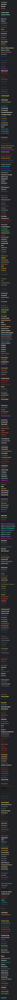

# Liste deutscher Farbnamen

[](https://www.npmjs.com/package/farbnamen)

Eine unvollständige Liste deutscher Farbnamen.

## Installation

```bash
npm install farbnamen
```

```js
import farben from 'farbnamen' with { type: 'json' };
// [{ name: 'Achatgrau', hex: '#b5b8b1', link: '…' }, …]
```

Ebenfalls verfügbar: `farbnamen/colors.min.json` und `farbnamen/colors.csv`.

## Entwicklung

```bash
npm install
npm run build   # lädt die Farben und erzeugt colors.svg / colors.html
npm test
```

## Quellen 📚

- [RAL-Farben](https://de.wikipedia.org/wiki/RAL-Farbe) (über die [Color Name API](https://api.color.pizza/v1/?list=ral))
- [Wikipedia: Liste der Farben im Farbkreis](https://de.wikipedia.org/wiki/Liste_der_Farben_im_Farbkreis)
- [BFW: HTML Farbtabelle](https://bfw.ac.at/020/farbtabelle.html)
- [Alpina pure farben](https://alpina-farben.de/sortiment/pure-farben/)

## List of Color Names 🔖 (**483**)


